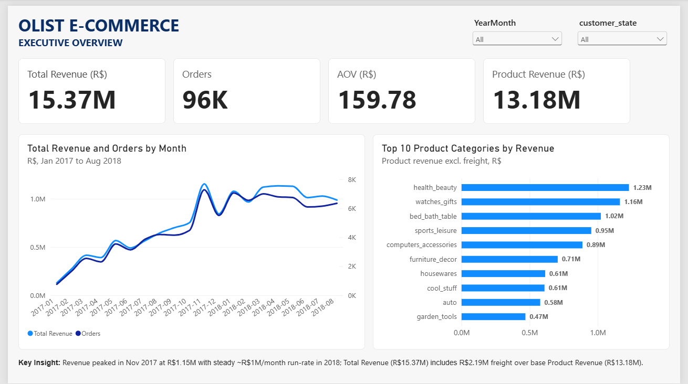
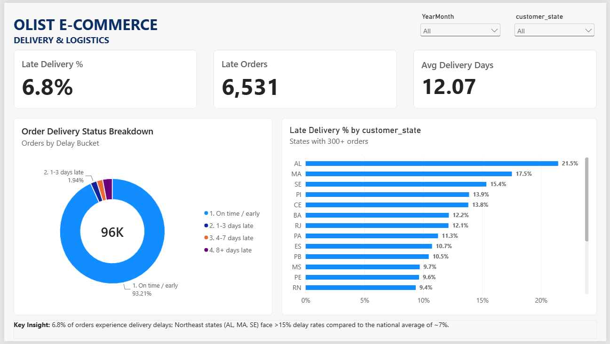
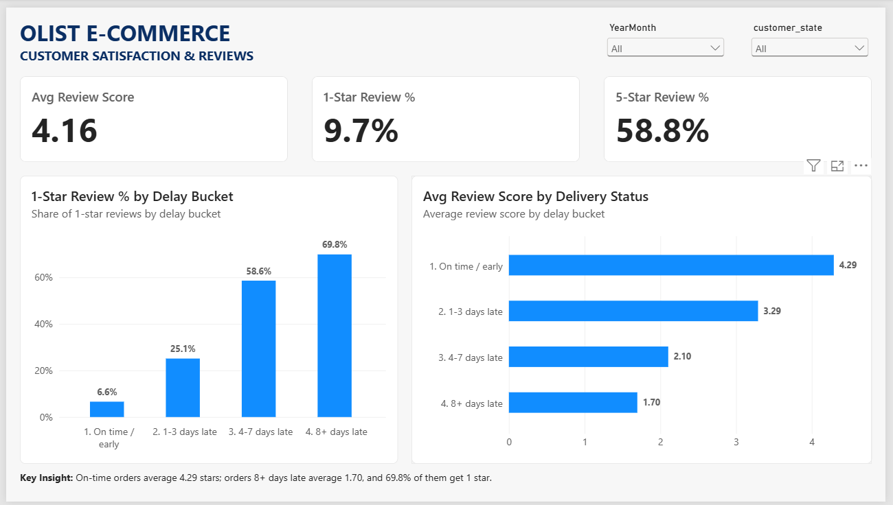

# Olist E-Commerce: Sales, Delivery & Customer Satisfaction Analytics

An end-to-end analysis of the Olist Brazilian e-commerce dataset (~100K orders). The main question: **how do late deliveries relate to customer review scores?** The dashboard covers about 96K delivered orders from Jan 2017 to Aug 2018.

**Tools:** MySQL, Python (pandas, SQLAlchemy), Power BI (DAX)

---

## Dashboard

### 1. Executive Overview

- **Key metrics:** R$15.37M total revenue (R$13.18M product + R$2.19M freight), 96K delivered orders, R$159.78 average order value.
- **Findings:** Monthly revenue peaked in Nov 2017 at R$1.15M, then held at roughly R$1M a month through 2018. The top categories by product revenue are `health_beauty` (R$1.23M), `watches_gifts` (R$1.16M) and `bed_bath_table` (R$1.02M).

### 2. Delivery & Logistics

- **Key metrics:** 6.8% late delivery rate (6,531 late orders) and 12.07 days average delivery time.
- **Findings:** 93.21% of orders arrive on time or early. Northeast states have the highest late rates, led by AL (21.5%), MA (17.5%) and SE (15.4%), more than double the national rate. Only states with 300+ orders are shown.

### 3. Customer Satisfaction & Reviews

- **Key metrics:** 4.16 average review score, 58.8% 5-star reviews, 9.7% 1-star reviews.
- **Findings:** Late delivery goes with much lower reviews. On-time orders average 4.29 stars (6.6% 1-star). Orders 1–3 days late average 3.29 (25.1% 1-star), 4–7 days late 2.10 (58.6%), and 8+ days late 1.70 (69.8% 1-star).

---

## Suggested Actions

- Focus delivery improvements on high-volume states with high late rates (RJ, BA, ES), where fixing delays would reach the most orders. RJ (12.1%) and BA (12.2%) have late rates about 2.5x higher than SP (4.5%).
- Flag orders heading toward 4+ days late early and contact the customer, since review scores fall sharply after that point.
- Review carrier and seller performance in the Northeast states with the highest late rates (AL, MA, SE).

---

## Approach

1. **Load:** Loaded the 9 Olist CSV files into MySQL (`olist` database) using `pandas` and `SQLAlchemy`.
2. **Clean and engineer features (Python, pandas):**
   - Converted date columns to `datetime`.
   - Kept only delivered orders that have a delivery date.
   - 551 orders had more than one review, so I kept the latest review per order.
   - Mapped Portuguese category names to English.
   - Created `delivery_days`, `delay_days`, `is_late` and `order_total` (item price + freight), and saved the result as the `clean_orders` table.
3. **SQL analysis (MySQL, see `sql/`):**
   - `01_monthly_revenue_mom.sql`: monthly revenue and month-over-month growth using `LAG`
   - `02_delay_buckets_review.sql`: review score and 1-star % by delay bucket
   - `03_top_categories_rank.sql`: top categories by revenue using `RANK`
   - `04_top_sellers_rank.sql`: top sellers with late % and average review
   - `05_state_delay_analysis.sql`: late rate by state
4. **Power BI:** Built a data model with 5 relationships and a date table, wrote DAX measures (`Total Revenue`, `Product Revenue`, `AOV`, `Orders`, `Late Delivery %`, `Avg Delivery Days`, `Avg Review Score`, `1-Star %`, `5-Star %`, `MoM Growth %`), and made 3 report pages with month and state slicers.

---

## Data Notes and Limitations

- This shows association, not cause. Late orders get lower reviews, but I did not control for product category, seller, price or other factors, so I cannot say lateness alone causes the drop.
- The dashboard covers Jan 2017 to Aug 2018. Late 2016 has almost no orders, which distorts growth numbers, and the dataset ends in Aug 2018.
- Delivery metrics use delivered orders only, so the late rate does not include canceled or undelivered orders.
- Total Revenue includes freight. Product Revenue does not.
- Some SQL results (such as RJ, BA and SP late rates) cover the full period, while the dashboard is filtered to Jan 2017 to Aug 2018, so small differences are expected.
- This is a public practice dataset, so there was no real-world stakeholder input or data refresh process.

---

## Repository Structure

```text
├── sql/                        # analysis queries
├── powerbi/
│   └── olist_analytics.pbix    # 3-page Power BI report
├── screenshots/
│   ├── page1_overview.png
│   ├── page2_logistics.png
│   └── page3_satisfaction.png
├── olist_analysis.ipynb        # loading, cleaning and feature engineering
├── .gitignore                  # excludes raw CSVs and notebook checkpoints
└── README.md
```

The raw CSV files are not included. Download them from Kaggle: *Brazilian E-Commerce Public Dataset by Olist* (kaggle.com/datasets/olistbr/brazilian-ecommerce).

## How to Run

1. Download the dataset from Kaggle and put the CSVs in a `data/` folder.
2. Install MySQL and create a database named `olist`.
3. In the notebook, set your own MySQL password (replace `YOUR_PASSWORD`) and the path to your `data/` folder, then run it to load and clean the data.
4. Run the queries in `sql/` in MySQL Workbench.
5. Open the `.pbix` file in Power BI Desktop. If you refresh it, point it to your own MySQL server.
